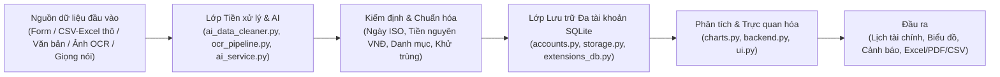

# BÁO CÁO BÀI TẬP LỚN CUỐI KỲ
## Học phần: Ngôn ngữ lập trình Python

**Tên đề tài:** Xây dựng ứng dụng **UniSpend** — Hệ thống Quản lý Thu Chi Sinh Viên UTH tích hợp AI Làm Sạch Dữ Liệu, OCR Hóa Đơn và Đa Tài Khoản SQLite bằng Python.

---

## 4.1. Phân tích bài toán

### 1. Tên đề tài
**UniSpend — Ứng dụng Quản lý, Phân tích Thu Chi Sinh Viên UTH tích hợp AI Làm Sạch Dữ Liệu và Quét Hóa Đơn OCR bằng Python.**

### 2. Lý do chọn đề tài
- Sinh viên đại học (đặc biệt sinh viên ở trọ tại TP.HCM như sinh viên Trường ĐH Giao thông Vận tải TP.HCM — UTH) thường quản lý tài chính cảm tính, ghi chép rời rạc trên giấy/Zalo/Excel nên dễ mất cân đối thu chi cuối tháng.
- Trong thực tế, khi muốn đưa dữ liệu thu chi có sẵn (từ sao kê, bảng tính, file tải từ Internet như Kaggle, hay ghi chú văn bản) vào phần mềm phân tích thì dữ liệu thường bị "bẩn": sai định dạng ngày, thiếu ghi chú, trùng lặp, lẫn giao dịch chuyển khoản nội bộ, danh mục không đồng nhất.
- Đề tài kết hợp đầy đủ các thế mạnh cốt lõi của **Python**: xử lý & phân tích dữ liệu (`pandas`, `altair`), cơ sở dữ liệu (`sqlite3`), giao diện web (`streamlit`, `fastapi`), thị giác máy tính & OCR (`opencv-python`, `Pillow`, `pytesseract`), tích hợp AI (`google-genai`, `pydantic`), và tự động hóa xuất báo cáo (`openpyxl`, `fpdf2`).

### 3. Bài toán thực tế cần giải quyết
1. **Ghi chép và kiểm soát dòng tiền cá nhân:** Nhập nhanh thu/chi thủ công, bằng giọng nói tiếng Việt, hoặc quét ảnh hóa đơn bằng OCR + AI.
2. **Tiền xử lý & làm sạch dữ liệu thô (Data Cleaning / ETL):** Tự động biến file `.csv`/`.xlsx` thô hoặc văn bản lộn xộn thành dữ liệu sạch 100% đúng chuẩn cơ sở dữ liệu web.
3. **Cô lập đa tài khoản dữ liệu:** Cho phép mỗi tệp SQLite (`.db`) hoạt động như một tài khoản độc lập để chuyển đổi, đối chiếu nhiều bộ dữ liệu khác nhau (tài khoản cá nhân, tài khoản sinh viên UTH, bộ dữ liệu thật Kaggle).
4. **Trực quan hóa & cảnh báo ngân sách:** Theo dõi lịch tài chính theo ngày/tháng, biểu đồ tỷ trọng danh mục, cảnh báo sớm khi sắp/đã vượt định mức, và xuất báo cáo Excel/PDF tự động.

### 4. Đối tượng sử dụng
- Sinh viên đại học (trọng tâm: sinh viên UTH) muốn theo dõi chi tiêu hằng tháng và đặt hạn mức tiết kiệm.
- Cá nhân hoặc nhóm sinh viên cần công cụ làm sạch dữ liệu tài chính thô và phân tích trực quan bằng Python.

### 5. Chức năng chính của chương trình
- **Quản lý giao dịch (CRUD):** Thêm, xem, lọc theo tháng/loại/danh mục/từ khóa, chỉnh sửa và xóa giao dịch thu/chi.
- **Lịch tài chính & Thống kê trực quan:** Lịch thu chi theo ngày, thẻ KPI (Tổng thu, Tổng chi, Số dư, Hạn mức chi an toàn/ngày), biểu đồ cột/tròn/xu hướng theo tháng bằng Altair.
- **Định mức ngân sách & Cảnh báo:** Đặt hạn mức tổng và từng danh mục theo tháng, tự động cảnh báo khi đạt ngưỡng ≥ 80% hoặc vượt 100%.
- **Quản lý đa tài khoản SQLite (`.db`):** Mỗi file `.db` là một tài khoản riêng biệt — hỗ trợ chuyển tài khoản, tạo tài khoản mới, đổi tên, xóa, và nhập file `.db` / `.csv`.
- **AI Làm sạch & Chuẩn hóa dữ liệu thô:** Nhận file `.csv`/`.xlsx` thô bất kỳ hoặc văn bản tự do → AI (Gemini/OpenAI + fallback offline) nhận diện cột, quy đổi tiền tệ, ánh xạ danh mục chuẩn, khử trùng lặp, loại chuyển khoản nội bộ → lưu 1 chạm thành tài khoản `.db` mới.
- **Quét hóa đơn AI (OCR) & Nhập giọng nói tiếng Việt:** Tiền xử lý ảnh hóa đơn (OpenCV/Pillow), nhận dạng văn bản (Tesseract OCR / Gemini Vision), phân tích câu nói số tiền tiếng Việt (`45k`, `1tr5`, `hai trăm nghìn`).
- **Xuất báo cáo & Sao lưu:** Xuất báo cáo `.xlsx` nhiều sheet, `.pdf` tiếng Việt Unicode, `.csv` UTF-8 BOM, và sao lưu/khôi phục nóng SQLite an toàn.

### 6. Dữ liệu đầu vào và kết quả đầu ra
- **Đầu vào (Input):**
  - Giao dịch nhập từ form (Ngày `YYYY-MM-DD`, Loại `Thu nhập / Chi tiêu`, Danh mục, Số tiền nguyên `VNĐ`, Ghi chú).
  - File dữ liệu thô `.csv` / `.xlsx` (VD: bộ dữ liệu thật *Daily Household Transactions* `2.461` dòng từ Kaggle) hoặc văn bản ghi chú thu chi tự do.
  - Ảnh hóa đơn (`.jpg`, `.png`) hoặc câu lệnh giọng nói tiếng Việt.
  - Hạn mức ngân sách theo tháng và tệp sao lưu SQLite `.db`.
- **Đầu ra (Output):**
  - Cơ sở dữ liệu SQLite sạch (`.db`) thỏa mãn 100% ràng buộc toàn vẹn `CHECK`.
  - Giao diện web trực quan (Lịch tài chính, KPI, biểu đồ Altair, cảnh báo ngân sách, tư vấn AI).
  - Các tệp báo cáo chuẩn hóa: Excel (`.xlsx`), PDF (`.pdf`), CSV (`.csv`).

---

## 4.2. Thiết kế chương trình

### 1. Sơ đồ luồng xử lý tổng quát


### 2. Cấu trúc thư mục chương trình
```text
quan-ly-chi-tieu-sinh-vien/
├── app.py                        # Điểm khởi chạy Streamlit (UniSpend 2.0 & UTH 3D)
├── main.py                       # Điều phối chế độ chạy (--demo, --legacy, --db, --api)
├── RUN.bat / DEMO.bat            # Tệp khởi chạy nhanh trên Windows
├── requirements.txt              # Danh sách thư viện Python cần cài đặt
├── expense_tracker/              # Gói chính UniSpend 2.0
│   ├── storage.py                # Lớp ExpenseStore, Transaction, BudgetStatus (SQLite + CHECK)
│   ├── accounts.py               # Quản lý đa tài khoản (mỗi file .db = 1 tài khoản độc lập)
│   ├── ai_data_cleaner.py        # Pipeline AI + ETL làm sạch CSV/Excel/Văn bản thô
│   ├── ai_service.py             # Dịch vụ Gemini/OpenAI, phân tích giọng nói & tư vấn tài chính
│   ├── ocr_pipeline.py           # Tiền xử lý ảnh OpenCV + Tesseract OCR + Pydantic schema
│   ├── extensions_db.py          # Lớp ExtensionsStore (hóa đơn, mục tiêu tiết kiệm, định kỳ, AI log)
│   ├── charts.py                 # Biểu đồ thống kê Altair
│   ├── reports_backup.py         # Xuất Excel (.xlsx), PDF (.pdf), sao lưu & khôi phục SQLite
│   ├── ui.py                     # Giao diện Streamlit đa màn hình (Lịch, Thống kê, AI Cleaner, Cá nhân)
│   └── utils.py                  # Hàm tiện ích định dạng tiền tệ, ngày tháng
├── unispend_3d/                  # Giao diện UniSpend UTH 3D & FastAPI backend
│   ├── models.py                 # Lớp OOP Transaction, BudgetConfig
│   ├── database.py               # Lớp ExpenseDatabase (SQLite + Pandas)
│   ├── backend.py                # Lớp ExpenseBackend xử lý nghiệp vụ
│   ├── accounts.py               # Quản lý đa tài khoản .db cho bản 3D
│   ├── csv_import.py             # Bộ đọc và kiểm định CSV chuẩn UTH
│   ├── api.py                    # REST API bằng FastAPI
│   └── app.py                    # Giao diện Streamlit 3D
├── scripts/                      # Công cụ sinh & làm sạch dữ liệu độc lập
│   ├── clean_real_dataset.py     # Pipeline ETL làm sạch dữ liệu thật Kaggle (2.461 -> 2.298 dòng)
│   └── generate_clean_dataset.py # Sinh & kiểm định bộ dữ liệu chuẩn 6 tháng sinh viên UTH
├── data/                         # Lưu trữ cơ sở dữ liệu SQLite & bộ dữ liệu đã kiểm định
│   ├── demo.db                   # Tài khoản Demo
│   ├── accounts/                 # Thư mục chứa các tài khoản .db do người dùng tạo/làm sạch
│   ├── clean_dataset/            # Bộ dữ liệu sạch sinh viên UTH (CSV, Excel, SQLite)
│   └── real_dataset/             # Bộ dữ liệu thật Kaggle (Raw + Clean CSV, Excel, SQLite)
└── tests/                        # Bộ 71 kiểm thử tự động (unittest + Streamlit AppTest)
```

### 3. Thiết kế Hướng đối tượng (OOP) & Module chính
| Module | Lớp / Hàm trọng tâm | Vai trò |
|---|---|---|
| `expense_tracker/storage.py` | `Transaction`, `BudgetStatus`, `ExpenseStore` | Đóng gói thực thể giao dịch/ngân sách, truy vấn SQL tham số hóa (chống SQL Injection), ràng buộc `CHECK`. |
| `expense_tracker/accounts.py` | `AccountInfo`, `list_accounts()`, `create_account()`, `rename_account()`, `delete_account()` | Quản lý mỗi file `.db` như 1 tài khoản độc lập, lưu trạng thái tài khoản đang mở. |
| `expense_tracker/ai_data_cleaner.py` | `CleaningResult`, `clean_tabular_file()`, `clean_raw_text()` | Kết hợp AI (Gemini/OpenAI) nhận diện schema/danh mục với ETL xác định bằng Pandas. |
| `expense_tracker/extensions_db.py` | `ReceiptRecord`, `SavingsGoal`, `RecurringItem`, `ExtensionsStore` | Lưu trữ tách biệt dữ liệu mở rộng theo từng tài khoản (`*_extensions.db`). |
| `expense_tracker/reports_backup.py` | `export_excel_bytes()`, `export_pdf_bytes()`, `create_sqlite_backup()`, `restore_sqlite_backup()` | Tự động hóa xuất báo cáo đa định dạng và sao lưu nóng SQLite (`sqlite3.backup`). |
| `unispend_3d/models.py` & `backend.py` | `Transaction`, `BudgetConfig`, `ExpenseBackend` | Mô hình OOP và lớp xử lý thống kê, cảnh báo vượt ngân sách. |

### 4. Cách lưu trữ và xử lý dữ liệu
- **Lưu trữ:** Sử dụng **SQLite3** cục bộ — mỗi tài khoản tương ứng một tệp `.db` riêng biệt kèm các ràng buộc toàn vẹn trực tiếp ở mức cơ sở dữ liệu (`CHECK(length(date) = 10)`, `CHECK(amount > 0)`, `CHECK(kind IN ('income','expense'))`, `CHECK` danh mục hợp lệ).
- **Xử lý tiền tệ:** Lưu bằng **số nguyên `INTEGER` (VNĐ)** để tránh hoàn toàn sai số dấu phẩy động (`float`).
- **Bảo mật & an toàn dữ liệu:** 100% truy vấn dùng tham số SQL (`?`), chặn CSV/Excel Formula Injection (`=`, `+`, `-`, `@`), lưu API key qua biến môi trường `.env` (không hardcode).

### 5. Các thư viện Python sử dụng
- **Giao diện & Web API:** `streamlit`, `fastapi`, `uvicorn`
- **Xử lý & trực quan hóa dữ liệu:** `pandas`, `altair`
- **Cơ sở dữ liệu:** `sqlite3` (thư viện chuẩn Python)
- **Xử lý ảnh & OCR:** `opencv-python-headless`, `Pillow`, `pytesseract`
- **AI & kiểm định dữ liệu:** `google-genai`, `pydantic`, `python-dotenv`, `requests`
- **Xuất báo cáo tự động:** `openpyxl` (Excel `.xlsx`), `fpdf2` (PDF Unicode `.pdf`)

---

## 4.3. Cài đặt chương trình

### 1. Kiểm tra lỗi đầu vào (Validation)
- Kiểm tra định dạng ngày ISO `YYYY-MM-DD`, chặn ngày không hợp lệ.
- Kiểm tra số tiền nguyên dương (`0 < amount <= 1.000 tỷ VNĐ`), từ chối số âm, số 0, ký tự lạ.
- Kiểm tra danh mục khớp loại giao dịch (`income` / `expense`) và giới hạn độ dài ghi chú ≤ 200 ký tự.
- Kiểm tra toàn vẹn tệp SQLite (`PRAGMA integrity_check`) trước khi khôi phục hoặc nhập làm tài khoản mới.

### 2. Hướng dẫn cài đặt và chạy chương trình
```powershell
# 1. Di chuyển vào thư mục dự án
cd "quan-ly-chi-tieu-sinh-vien"

# 2. Tạo môi trường ảo và cài đặt thư viện
python -m venv .venv
.\.venv\Scripts\activate
pip install -r requirements.txt

# 3. (Tùy chọn) Cấu hình Gemini API Key trong file .env từ .env.example
# GEMINI_API_KEY=your_api_key_here

# 4. Chạy ứng dụng
# Cách 1: Giao diện UniSpend 2.0 (Lịch tài chính + AI Làm sạch + Đa tài khoản)
python main.py --demo

# Cách 2: Giao diện UniSpend UTH 3D
python main.py

# Cách 3: Chạy trực tiếp bằng tệp .bat trên Windows
DEMO.bat   # hoặc RUN.bat

# 5. Chạy bộ kiểm thử tự động (71 test cases)
python -m unittest discover -s tests -t .
```

---

## 4.4. Kiểm thử và đánh giá

### 1. Kết quả kiểm thử tự động & kiểm định dữ liệu
- **Kiểm thử phần mềm (`unittest` + `Streamlit AppTest`):** Đạt **71/71 test cases PASS** (kiểm tra CRUD SQLite, tính toán ngân sách, import/export CSV/Excel/PDF, giao diện UniSpend 2.0 & 3D, chuyển đổi đa tài khoản khi tải lại trang).
- **Kiểm thử làm sạch dữ liệu thật từ Internet** (*Daily Household Transactions* — Kaggle/GitHub):
  - Đầu vào thô: **2.461 dòng** (có `160` dòng `Transfer-Out`, `9` dòng trùng lặp, `521` dòng thiếu `Note`, `38` nhãn danh mục tiếng Anh không đồng nhất, tiền `INR`).
  - Đầu ra sạch: **2.298 dòng sạch** (`2015-01-01` → `2018-09-20`), `0` lỗi thiếu/trùng/sai định dạng, PASS 100% ràng buộc `CHECK` SQLite và bộ đọc CSV.
  - Tổng thu: `912.723.000 VNĐ` | Tổng chi: `586.636.000 VNĐ` | Tỷ lệ tiết kiệm: `35,7%`.
  - Nhận xét phân tích: *Ăn uống* có tần suất cao nhất (`910` giao dịch — ~42% số lần chi) nhưng chỉ chiếm `5,6%` tổng tiền; nhóm *Khác* (đầu tư, quỹ, y tế gia đình) chiếm `63,9%` tổng chi.
- **Kiểm thử bộ dữ liệu sạch Sinh viên UTH (6 tháng `06–11/2026`):**
  - `151` giao dịch sạch (`0` lỗi trên cả 6 tiêu chí QA).
  - Tổng thu: `41.180.000 VNĐ` | Tổng chi: `27.372.000 VNĐ` | Tỷ lệ tiết kiệm: `33,5%`.
  - Nhận xét phân tích: 2 khoản thiết yếu chiếm **`75,1%` tổng chi** gồm *Tiền trọ* (`49,2%`) và *Ăn uống* (`25,9%` qua `64` giao dịch); các khoản *Đi lại* (`7,9%`), *Học tập* (`5,2%`), *Giải trí* (`4,5%`) được kiểm soát ổn định.

### 2. Đánh giá tổng quan
- **Ưu điểm:**
  - Giải quyết trọn vẹn quy trình khép kín từ **dữ liệu thô → AI làm sạch → lưu trữ SQLite đa tài khoản → trực quan hóa & xuất báo cáo**.
  - Kiến trúc module hóa rõ ràng, áp dụng OOP, có kiểm thử tự động (`71` test) và chạy ổn định cục bộ không phụ thuộc máy chủ ngoài.
  - Có cơ chế fallback offline cho AI nên vẫn hoạt động tốt ngay cả khi chưa cấu hình API key hoặc mất mạng.
- **Hạn chế còn tồn tại:**
  - Lưu trữ cục bộ bằng SQLite trên từng máy tính cá nhân, chưa đồng bộ thời gian thực qua đám mây giữa nhiều thiết bị.
  - Độ chính xác OCR hóa đơn phụ thuộc vào chất lượng ảnh chụp (ánh sáng, độ mờ, nếp gấp giấy).
  - Chưa tích hợp đăng nhập mật khẩu/phân quyền người dùng ở mức ứng dụng.
- **Hướng phát triển tiếp theo:**
  - Tích hợp mô hình học máy (`scikit-learn` / chuỗi thời gian) dự báo chi tiêu tháng kế tiếp và phát hiện giao dịch bất thường (Anomaly Detection).
  - Hỗ trợ đồng bộ đa thiết bị với xác thực người dùng (PostgreSQL / Supabase) và tự động đọc thông báo biến động số dư ngân hàng.
